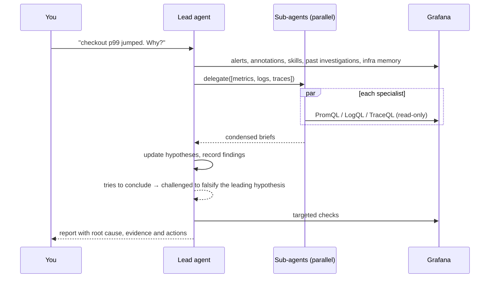

# Investigations

Switch the header to **Investigate**, or use *Investigate with Augur* from a panel or alert, and describe the symptom.

## What you see

- **Timeline:** every query as it runs, labelled by sub-agent (`[metrics]`, `[logs]`, `[traces]`), with results you can expand.
- **Hypothesis board:** candidate causes with status (**open**, **supported**, **refuted**, **confirmed**), confidence, and whether the hypothesis was challenged.
- **Findings:** facts recorded along the way, by severity, each citing its evidence (`E3`).
- **Report:** summary, timeline, evidence with Explore links, root cause, and recommended actions.

## How it works

- **Sub-agents.** The lead agent can start up to four specialists at once. Each has its own context, a read-only toolset, a 12-step budget, and returns a brief of about 6k characters, so the lead stays focused while specialists dig deep.
- **Hypotheses are explicit.** Every candidate cause is tracked with evidence. When the lead tries to finish, a **conclusion gate** sends it back once to try to disprove its leading hypothesis (timing, unaffected peers, alternatives), unless it already did.
- **The board stays current.** After four rounds of queries with nothing recorded, Augur is reminded to update findings and hypotheses, so what you see, and what survives an interruption, is up to date.
- **Evidence ledger.** Every data query is recorded with the datasource, query, absolute time range, a SHA-256 digest of the response, and frame/row counts. Findings cite ledger ids.

## Context Augur starts from

- Firing alerts and recent annotations (deploys)
- Your org's rules and matching skills
- [Infrastructure memory](../configure/app-settings.md#infrastructure-memory): services and dependencies
- Similar past investigations
- [Installed apps and plugins](../reference/tools.md#knowing-your-grafana)

## Verifying the evidence

**Verify evidence** (in the footer once an investigation has answered) re-runs every query in the evidence ledger exactly as recorded, using the same datasource, query and absolute time range, and compares the data with what the conclusions were based on:

| Result | Meaning |
|---|---|
| **identical** | The same data came back |
| **changed** | The data for that window is different now: late-arriving samples, a backfill, recording rules catching up, or a relabelling |
| **unavailable** | The query can't run any more: retention expired, the datasource was removed or renamed, or you lack permission |
| **inconclusive** | Recorded before Augur 1.9 (no data digest) and only metadata differs; frame and row counts match |

Findings and hypotheses that cite changed or unavailable evidence (`E#`) are listed under **Re-examine**. The comparison uses a digest of the data alone (frames, fields, labels, values), so query statistics and series order don't matter.

Verify before you rely on an investigation, for example when writing a postmortem a few days later or when a conclusion is disputed. The latest verification goes into Markdown and PDF reports and into the investigation when you save it.

Saved investigations embed their full ledger, so they can be verified later too: ask *"verify the evidence of last week's checkout investigation"*. Augur also verifies a past investigation before leaning on its conclusion.

## Finishing

- **Save to Grafana** creates a dashboard with the report, findings, hypotheses, evidence panels and annotations, in the investigations folder (your folder permissions apply). Saved investigations are searchable in future ones.
- **Markdown** and **PDF** export the report. See [Reports and export](reports.md).

## Tips

- Give a start time if you know it: *"since 14:20 UTC"*.
- Say what's normal: *"usually 200ms"*.
- If Augur goes down a wrong path, stop and redirect: *"Ignore the DB; the problem started before the migration."*
